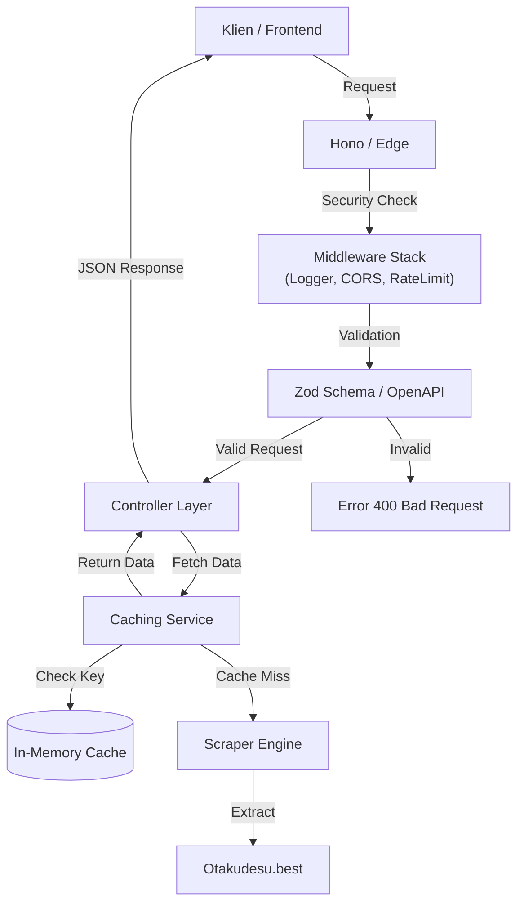

<div align="center">

# ⚡ Anime Sub Indo API 


**Layer agregasi data anime berkinerja tinggi, aman tipe data, dan dibangun untuk skala besar.**  
*Overhead latensi nol. Validasi tingkat enterprise. Siap untuk Edge Network.*

</div>

---

### 🚀 Features

- **⚡ Kecepatan Ekstrem**: Dibangun di atas **Hono**, berjalan secara native di Edge. Overhead routing di bawah satu milidetik.
- **🛡️ Integritas Tipe Data**: Keamanan tipe *end-to-end* dengan validasi skema **Zod**. Menjamin reliabilitas waktu kompilasi dan waktu jalan.
- **👁️ Observabilitas Penuh**: Dilengkapi dengan pencatatan permintaan (*request logging*) terintegrasi dan pemantauan kesehatan sistem (*health monitoring*) untuk keandalan tingkat produksi.
- **🔒 Keamanan Enterprise**: 
    - **Pembatasan Laju (Rate Limiting)**: Algoritma mitigasi untuk mencegah serangan DDoS dan penyalahgunaan.
    - **Kebijakan CORS**: Kontrol asal yang ketat untuk lingkungan produksi yang aman.
- **📖 Dokumentasi Mandiri**: Spesifikasi **OpenAPI 3.1** yang dibuat secara otomatis dan antarmuka Swagger UI yang interaktif.

---

## 🏗️ System Architecture

Dirancang menggunakan pola desain **Controller-Service-Route** yang modular untuk memastikan pemeliharaan jangka panjang dan skalabilitas horizontal.



---

## 🛠️ Tech Stack

- **Runtime**: Node.js / Bun (Kompatibel sepenuhnya)
- **Framework**: [Hono](https://hono.dev) - Kerangka kerja web untrafast untuk Edge.
- **Validasi**: [Zod](https://zod.dev) - Validasi skema berbasis TypeScript.
- **Dokumentasi**: [Swagger UI](https://swagger.io) - Dokumentasi API interaktif.
- **Resiliensi**: Penanganan Kesalahan Kustom & Strategi Fallback.
- **Infrastruktur**: Vercel Serverless Functions.

---

## ⚡ Quick Start

### Prerequisites

- Node.js 18+ atau Bun
- Git

### Installation

```bash
# Kloning repositori
git clone https://github.com/ByteDataFlow/animesubindo-api.git

# Navigasi ke direktori proyek
cd animesubindo-api/backend

# Instalasi dependensi
npm install
```

### Development

```bash
# Jalankan server pengembangan dengan hot-reload
npm run dev
```

> API akan tersedia di `http://localhost:3000`.  
> Dokumentasi Swagger UI dapat diakses di `http://localhost:3000/ui`.

---

## 📚 Endpoint API

| Metode | Endpoint | Deskripsi |
| :--- | :--- | :--- |
| `GET` | `/api/home` | Mengambil data anime yang sedang tayang (ongoing) dan tamat |
| `GET` | `/api/search?q={query}` | Pencarian anime berdasarkan judul |
| `GET` | `/api/anime/{slug}` | Mengambil metadata detail anime |
| `GET` | `/api/episode/{slug}` | Mengambil tautan streaming dan unduhan |
| `GET` | `/health` | Pemeriksaan kesehatan aplikasi & metrik sistem |

*Silakan lihat ke [Dokumentasi Swagger](/ui) untuk referensi API lengkap.*

---

## 🚢 Penerapan (Deployment)

Dapat diterapkan secara mulus ke **Vercel** tanpa konfigurasi tambahan yang rumit.

```bash
# Deploy menggunakan Vercel CLI
vercel --prod
```

---

## ⚠️ Catatan Sumber Data (Penting!)

Karena kita ngambil data dari **Otakudesu**, ada kemungkinan struktur web atau domain mereka berubah sewaktu-waktu. 

Tenang, arsitektur kita udah siap. Kalau ada error karena perubahan di sana, lo cuma perlu benerin satu file ini:
👉 **`src/scrapers/otakudesu.ts`**

Gak perlu otak-atik Controller atau Router. Cukup sesuaikan selector di file itu, dan API bakal jalan normal lagi.

---

## ⚠️ Disclaimer

Proyek ini adalah API tidak resmi dan tidak berafiliasi, didukung, atau disponsori oleh **Otakudesu**.
Semua data dan media adalah properti dari pemilik masing-masing.

- **Sumber Data**: [Otakudesu](https://otakudesu.best) - Terima kasih atas konten yang luar biasa.
- **Pengarang**: [ByteDataFlow](https://github.com/ByteDataFlow)

---

<div align="center">

**Dibangun dengan ☕ dan < /> oleh [ByteDataFlow](https://github.com/ByteDataFlow)**


</div>
